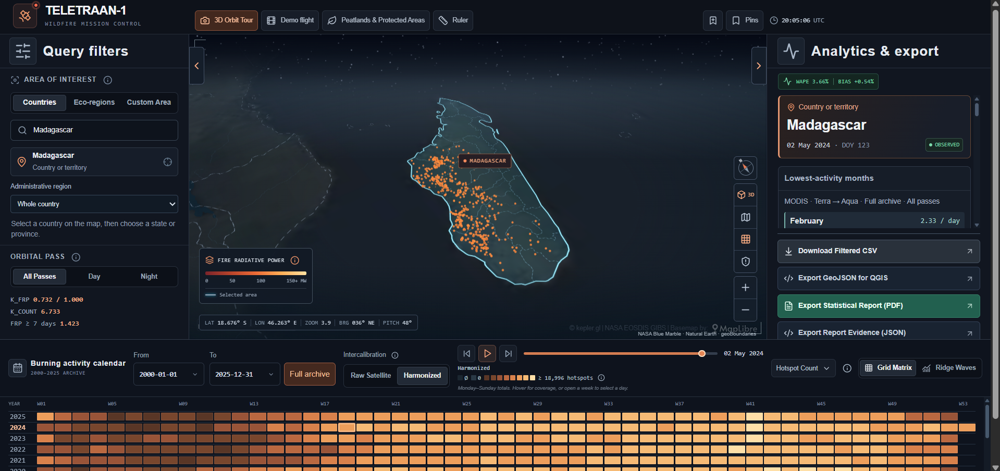
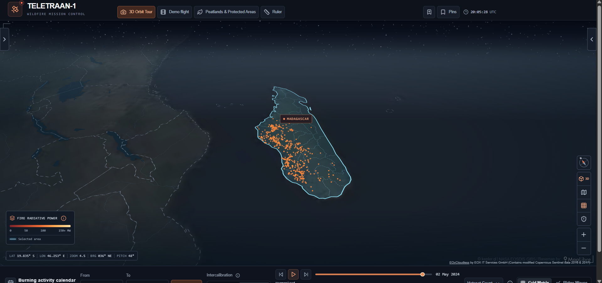
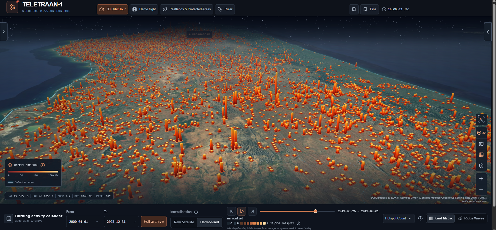
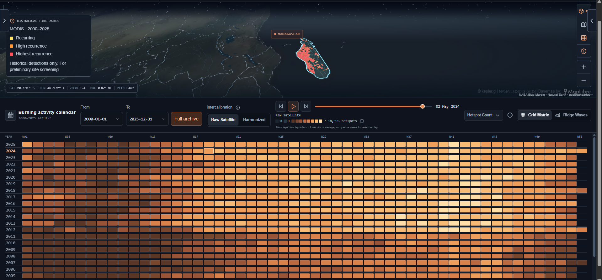
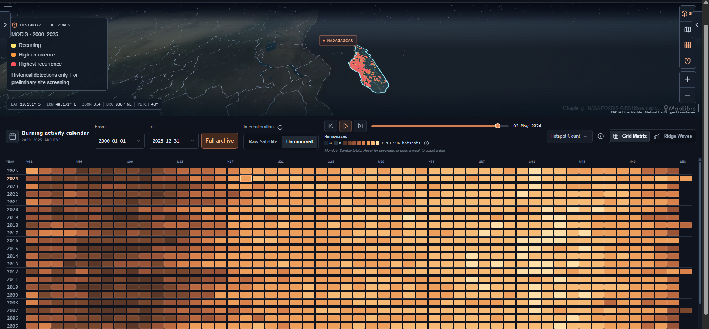
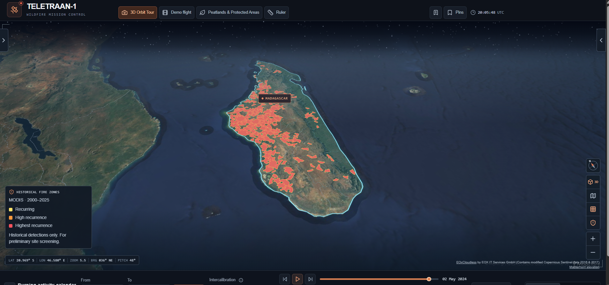

# TELETRAAN-1

TELETRAAN-1 is a global wildfire exploration and analysis tool. It combines NASA FIRMS satellite detections from Terra and Aqua MODIS and Suomi NPP VIIRS into a searchable 2000–2025 archive. Use it to explore a region's fire history, compare seasons and years, screen candidate sites for recurring fire activity, and export the underlying observations for further analysis.

[Install and run locally](#install-and-run-locally) · [Explore the application](#use-the-application) · [Build historical fire zones](#build-the-historical-fire-zone-layer) · [Build the frontend](#build-the-frontend-optional) · [Troubleshooting](#troubleshooting) · [Team](#team)



*The full workspace brings area filters, the map, the burning activity calendar, and analytics together.*

## Install and run locally

### 1. Install Python and Node.js

- Install Python 3.13. On Windows, select **Add Python to PATH** if the installer offers it, then open a new terminal. [Python downloads](https://www.python.org/downloads/)
- Install Node.js 24 with npm. The launcher uses npm to install the frontend dependencies on the first run. [Node.js downloads](https://nodejs.org/en/download)
- Allow about **15 GB of free space** for the downloaded ZIP, the extracted data, and project dependencies. Keep an internet connection available for the downloads, initial dependency installation, and online map imagery.

To check the installations, open a terminal and run these commands one at a time. Each should print a version number.

```text
python --version
node --version
npm --version
```

On macOS and Linux, use `python3 --version` if needed. In Windows PowerShell, use `py --version` if Python is available through the Windows launcher, or `npm.cmd --version` if PowerShell blocks the npm script.

### 2. Download and extract the project

On GitHub, open the version of the repository that contains this README, choose **Code → Download ZIP**, and extract the ZIP to a folder you can write to, such as `Documents`. Open the extracted project folder and look for `run.py`, `data-path.txt`, `backend`, and `frontend`. If you already have a Git checkout of this version, use that folder.

### 3. Download and extract the dataset

Download `teletraan-data-v1.zip` from Google Drive. The ZIP is about **5.7 GB**, and its extracted copy takes about the same space. Wait for the download to finish, then use **Extract All** on Windows or your operating system's archive utility. [Download the historical archive from Google Drive](https://drive.google.com/file/d/1sw6DNckrXZRQNZCQqir76tpSXErcL8oL/view)

Open the extracted `teletraan-data-v1` folder. It should contain these items directly inside it.

```text
teletraan-data-v1/
├── RELEASE.json
└── artifacts/
```

Some extraction tools create an extra folder with the same name. If you see two nested `teletraan-data-v1` folders, open the inner one and confirm that `RELEASE.json` and `artifacts` are there.

### 4. Point the application to the dataset

In the **project** folder, open `data-path.txt` in a text editor such as Notepad. Replace the existing contents with the full path of the **folder that contains `RELEASE.json`**, on one line, and save the file as UTF-8.

Example for Windows

```text
C:\Users\YourName\Downloads\teletraan-data-v1
```

Examples for macOS and Linux, respectively

```text
/Users/yourname/Downloads/teletraan-data-v1
/home/yourname/Downloads/teletraan-data-v1
```

On Windows, open the dataset folder in File Explorer, press **Alt+D**, and copy the folder path from the address bar. Spaces in the path are supported. If you extracted the archive directly into the project's `data` folder, the default line `data/teletraan-data-v1` already points to the right place. The application reads the dataset in that location.

### 5. Start the website and API

Open a terminal **in the project folder containing `run.py`**. In Windows File Explorer, right-click an empty area inside the folder and choose **Open in Terminal**. On macOS or Linux, open a terminal and use `cd` to go to the extracted project folder.

```sh
python run.py
```

You can use `py run.py` on Windows or `python3 run.py` on macOS and Linux if that is how your Python command is named. On the first run, the launcher creates the local Python environment, installs the backend and frontend dependencies, checks the dataset, and starts both services. Wait for Vite to print its **Local** address before opening the website.

The website runs on port **5173** and the API on port **8000**. Keep the terminal open while using the application. Press **Ctrl+C** in that terminal to stop both services. Run the same command to start them again. [Open TELETRAAN-1](http://127.0.0.1:5173/)

### 6. Check that the archive is working

1. Open **API readiness**. You should see `"status":"READY"` and `"dataset_release":"teletraan-data-v1"`. [API readiness](http://127.0.0.1:8000/health/ready)
2. Open the included Amazon example for August 2019. On the first request for an area, **Loading archive values…** can remain visible while the API scans the dataset. [Open the Amazon example](http://127.0.0.1:5173/?scenario=amazon&from=2019-08-01&to=2019-08-31&metric=count)
3. Hover over a colored week to read its total and the number of days with values. Click the week to open its seven daily cells, then click a day to see its observations on the map.
4. Select **Full archive** beside **From** and **To** to browse all years. Select it again to return to August 2019.

## Use the application

### Choose an area and an orbital pass

The **Query filters** panel controls the geographic selection. Use **Countries** to search for a country or select one on the map. Use **Administrative region** to narrow to a state or province where boundaries are available. **Eco-regions** lets you search by ecological region. Under **Custom Area**, choose **Radial Circle**, **Freehand Lasso**, or **Enter Lat/Lon** to define your own search area.

Choose **All Passes**, **Day**, or **Night** to filter observations by orbital pass. The selected area and pass define the observations used by the calendar, map, and reports.

### Explore hotspots on the map

Use the chevrons at the edges of the map to collapse **Query filters** and **Analytics & export** for a wider view. Use the right-hand toolbar to zoom, reset north, switch between the map and satellite imagery, toggle the aggregation grid, or switch between overhead and tilted views. Enable **Peatlands & Protected Areas** in the top toolbar to add geographic context.



*Collapsing the panels leaves more room to inspect the selected area and its hotspots.*

In the tilted view, hotspot cells rise as **3D columns**. Taller columns represent higher fire radiative power (FRP) on a compressed display scale. In a weekly view, the column represents the sum of daily FRP readings in that grid cell. The map can use FRP for the columns while the calendar separately displays **Hotspot Count**. Use the map legend to see which quantity the columns represent.



*The tilted view makes differences in FRP easier to see across neighboring grid cells.*

### Read the burning activity calendar

- **From** and **To** set the active date range. The grid greys out weeks outside that range. **Full archive** makes the entire 2000–2025 period available, and pressing it again restores the previous date range.
- **Grid Matrix** shows a row per year and a cell per Monday–Sunday week. **Ridge Waves** shows the same weekly activity as profiles. Drag the top edge of the calendar up to see more years.
- Choose **Hotspot Count** for detection totals, **FRP** for fire radiative power, or **Z-Score** for how unusual the observed FRP was relative to a seasonal MODIS baseline. The weekly Z-score view displays the available daily score farthest from zero.
- Hover over a week to inspect its value and the number of days with readings. Click a week to open its daily cells, or use the arrows, scrubber, and play button to move through weeks. The legend distinguishes a missing value from an observed zero.

### Compare Raw Satellite and Harmonized

MODIS and VIIRS have different detection characteristics. When the calendar starts using S-NPP VIIRS data in January 2012, the **Raw Satellite** view can show a visible step in hotspot counts. **Harmonized** applies pass-specific calibration to the earlier MODIS values to make them more comparable with VIIRS. The estimated adjustment reduces the step in this Madagascar example. How closely the two series align varies by location and time period.



*Raw Satellite. The change in recorded hotspot counts is visible around the introduction of VIIRS in 2012.*



*Harmonized. The adjusted early MODIS values make the comparison across the sensor transition more consistent.*

### Explore historical fire zones

When the local index is available, select the shield icon labeled **Historical fire zones** in the map toolbar. The layer displays polygons where MODIS repeatedly recorded fire activity over the archive. Yellow, orange, and red represent **Recurring**, **High recurrence**, and **Highest recurrence**. The current area controls which polygons appear. The date range and day/night filter do not change this layer.

The index highlights only locations that meet its recurrence thresholds. Use it to flag a potential building site for further investigation or compare candidate locations. The colors describe recorded recurrence. A site-specific risk assessment also needs evidence about terrain, vegetation, buildings, and current conditions. [Fire zone methodology](backend/HISTORICAL_QUERIES.md#historical-fire-zones)



*The historical fire zone layer highlights recurring clusters on the satellite basemap.*

### Measure distances, save views, and export data

- **Ruler** measures the distance between two map locations. Turn it on, then drag from a hotspot or site to a nearby feature you want to measure against.
- **Save pin** opens a form to name the current view. **Pins** reopens saved views and built-in scenarios. Custom pins are stored in the browser you used to create them.
- **3D Orbit Tour** and **Demo flight** move the camera through built-in showcase regions.
- **Analytics & export** summarizes the selected observations. **Lowest-activity months** ranks months using historical daily MODIS detection counts for the selected area and orbital pass.

| Export | What it contains |
| --- | --- |
| **Download Filtered CSV** | Detection metrics for the selected day and area, with the active orbital pass and spatial grid applied. |
| **Export GeoJSON for QGIS** | Geographic grid features for the selected day. Open the file as a vector layer in a GIS tool such as QGIS. |
| **Export Statistical Report (PDF)** | Charts, tables, and methods for the selected area and date range, with source and calibration details. |
| **Export Report Evidence (JSON)** | The source response and derived values used by the historical report. Keep it alongside the PDF for review. |

[Historical report and evidence guide](docs/HISTORICAL_REPORT.md)

## Build the historical fire zone layer

The downloaded archive provides the observations. Generate the separate global recurrence index once per data release to enable the **Historical fire zones** layer.

1. Complete the local setup first so the project's `.venv` and `data-path.txt` are ready.
2. Open a second terminal in the project folder containing `run.py`. Run the command for your system.

   **Windows (PowerShell)**

   ```powershell
   .\.venv\Scripts\python.exe backend/scripts/build_fire_zones.py
   ```

   **macOS and Linux**

   ```sh
   ./.venv/bin/python backend/scripts/build_fire_zones.py
   ```

3. Wait for the script to finish scanning and clustering the global archive. It prints the location of a GeoJSON file under `data/work/fire-zones` when done. Return to the website and enable the shield icon. If the layer was already selected, switch it off and on or refresh the page.

The application can load the finished index while the local API is running. Keep the generated file for future sessions. [Index configuration and methodology](backend/HISTORICAL_QUERIES.md#historical-fire-zones)

## Build the frontend (optional)

The regular launcher runs the application with Vite. To create the optimized static frontend files, first complete the local setup and leave the API running. Then open a second terminal in the project folder.

**Windows (PowerShell)**

```powershell
cd frontend
$env:VITE_FIRMS_API = 'http://127.0.0.1:8000'
node node_modules/typescript/bin/tsc -b
node node_modules/vite/bin/vite.js build --configLoader runner
node node_modules/vite/bin/vite.js preview --configLoader runner --host 127.0.0.1 --port 4173 --strictPort
```

**macOS and Linux**

```sh
cd frontend
export VITE_FIRMS_API=http://127.0.0.1:8000
node node_modules/typescript/bin/tsc -b
node node_modules/vite/bin/vite.js build --configLoader runner
node node_modules/vite/bin/vite.js preview --configLoader runner --host 127.0.0.1 --port 4173 --strictPort
```

Vite writes the build to `frontend/dist/`. Open the preview URL to check the build against the running API. For deployment, set `VITE_FIRMS_API` to the API address before building, or configure the web server to route the same-origin `/api/v2` requests and set `VITE_FIRMS_API` to an empty value. [Open local build preview](http://127.0.0.1:4173/) · [Frontend and deployment guide](frontend/README.md)

## Troubleshooting

| What you see | What to do |
| --- | --- |
| `python`, `node`, or `npm` is unavailable | Reopen the terminal after installation and run the version checks above. Use `py` or `python3` if that is your Python command. |
| Python cannot open `run.py` | Open the extracted project folder that contains `run.py` and launch the terminal there. |
| `data-path.txt must point to the extracted folder containing RELEASE.json` | Open the dataset folder in your file manager, verify that `RELEASE.json` is directly inside it, then paste that folder path into `data-path.txt`. |
| A partition is missing or damaged | Check that the download and extraction completed. Extract a fresh copy of the ZIP and update the path if needed. |
| Port `5173` or `8000` is already in use | If TELETRAAN-1 is already running, open the website. To restart it, stop the earlier launcher with **Ctrl+C**, then run it again. |
| The page opens but the calendar is still loading | Check **API readiness**, then try the Amazon example. A first query for a large area can take longer while the archive is scanned. |
| Weeks outside the date range are greyed out | Select **Full archive**, or adjust **From** and **To**. |
| The historical fire zone layer is unavailable | Generate the recurrence index using the commands above, then reload the map. |

## Data and implementation

The portable Parquet release contains **392,568,931** canonical detection records. MODIS coverage in the archive starts on 1 November 2000, and S-NPP VIIRS starts on 20 January 2012. Both end on 31 December 2025. A hotspot count measures recorded satellite detections and can include multiple observations of the same fire. FRP measures power in megawatts. Observational gaps and differences between instruments affect comparisons across locations and years. [NASA FIRMS](https://firms.modaps.eosdis.nasa.gov/) · [Release manifest](docs/data-release/RELEASE.json) · [ZIP SHA-256](docs/data-release/teletraan-data-v1.zip.sha256)

The frontend uses React, TypeScript, Vite, Kepler.gl, and MapLibre. FastAPI serves historical queries, and DuckDB reads the local Parquet files. The launcher checks the published manifest and the observation file sizes. For full checksum verification, use the importer from the project folder.

```sh
python backend/scripts/import_data_release.py --archive /path/to/teletraan-data-v1.zip --output /path/to/firms-data
```

Point `data-path.txt` to the importer output's `teletraan-data-v1` folder. A separately managed API can use `FIRMS_DATA_ROOT` to point to the verified release folder. [API storage and configuration](backend/HISTORICAL_QUERIES.md) · [Geographic data and imagery credits](frontend/README.md#geographic-data)

## Team

TELETRAAN-1 was developed by team **Deceptіcons**.

- Ihor Movchan
- Hlib Piatachenko
- Daniil Cherniavskyi
